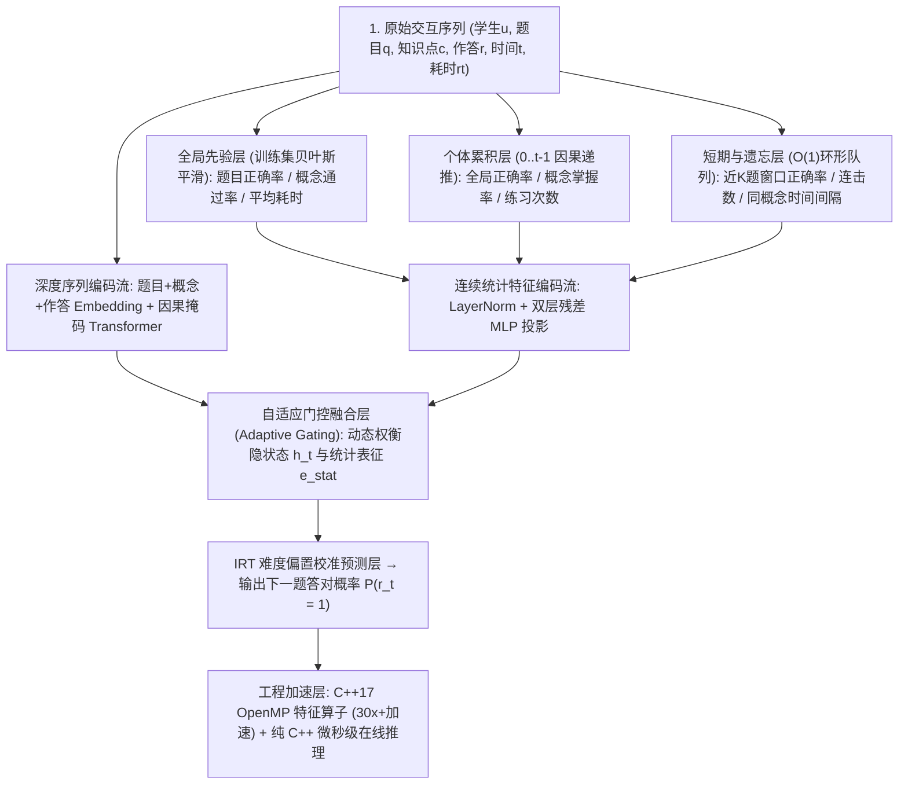

# 《融合历史统计特征的知识追踪方法研究》毕业设计全流程总规划方案

> **【核心立意总结】**：针对现有深度知识追踪（DKT、SAKT、AKT 等）过度依赖隐式 ID 嵌入导致的**冷启动表现差、细粒度行为先验缺失、可解释性弱**三大痛点，显式构建零数据泄露的**三层十维历史统计特征体系**，通过**双流自适应门控网络（HSF-KT）**融合统计先验与序列语义；并进一步采用 **C++17 + OpenMP** 实现高性能增量特征算子与微秒级在线推理引擎，兼顾学术指标创新与工业级工程落地。

---

## 一、 选题剖析：为什么做“融合历史统计特征”？

在开题和最终答辩中，评委最常问的核心问题是：**“深度神经网络自己就能从交互序列里学习规律，为什么要显式融合历史统计特征？”** 你的整个研究故事线应围绕以下三大痛点展开：

1. **缓解冷启动与长尾稀疏问题（Cold-Start & Sparsity）**
   - 纯 ID 嵌入模型（如 DKT、SAKT）需要大量交互才能训练好题目与知识点的 Embedding。面对交互步数较短的新生（序列冷启动）或低频长尾题目时，隐式表征极不稳定；而**题目历史全局平滑正确率、知识点先验通过率、学生前几题滑动统计**能直接提供强先验锚点。
2. **捕捉细粒度学习行为动态（Fine-Grained Behavioral Priors）**
   - 传统模型仅输入 `(题目, 知识点, 对错)` 三元组，丢失了显式的行为状态信号，例如：**近 K 题滑动窗口正确率**（短期状态起伏）、**连续答对/答错连击数（Streak）**（流体验或挫败/猜题状态）、**同一知识点练习间隔时间**（艾宾浩斯遗忘效应）、**相对作答耗时比**（熟练掌握 vs 苦思挣扎）。
3. **提升预测可解释性与在线服务性能（Interpretability & Low-Latency Engineering）**
   - 显式统计特征具有明确的教育测量学含义（对应经典 IRT 项目反应理论中的难度与能力先验），通过门控权重可视化可直观解释预测依据；同时借助 **C++17 环形队列与哈希状态机**，可在百万级日志与高并发在线刷题场景下实现 `O(1)` 微秒级状态更新与实时推理。

---

## 二、 核心方法与模型架构设计（三大递进模块）

### 模块 1：防数据泄露的三层十维历史统计特征体系

> **【防穿越红线（Data Leakage Prevention）】**：预测第 $t$ 步作答 $r_t$ 所用的个体统计量，**严格只能利用 $0 \sim t-1$ 步的历史记录**；题目与知识点全局统计量**只能在训练集（Train Split）上拟合**并映射到验证/测试集，严禁在全量数据上直接求均值！

| 特征层级 | 维度序号与特征名称 | 计算方法与平滑策略 | 教育测量学物理含义 |
| :--- | :--- | :--- | :--- |
| **全局静态先验层**（仅训练集拟合） | `[0]` 题目平滑正确率、`[1]` 知识点平滑正确率 | 贝叶斯平滑：$\hat{p}_q = \frac{C_q + \alpha \bar{r}}{N_q + \alpha}$，避免低频题出现极端 0% 或 100% | 客观题目难度先验、知识点基准通过率 |
| **个体长期累积层**（$0 \dots t-1$ 递推） | `[2]` 学生全局正确率、`[3]` 总作答数对数、`[4]` 目标知识点掌握率、`[5]` 目标知识点练习数对数 | 在线 `O(1)` 累加更新；次数特征采用 $\ln(1 + N)$ 压缩长尾分布 | 学习者综合能力基线、特定概念熟练度 |
| **短期窗口与遗忘层**（滑动窗口与时序） | `[6]` 近 $K$ 题窗口正确率、`[7]` 连对/连错连击值、`[8]` 同概念遗忘时间差对数、`[9]` 上一题相对耗时比 | 环形队列维护窗口和；连击数经 $\tanh(\text{streak}/5)$ 缩放；时间差取 $\ln(1 + \Delta t)$ | 近期专注/疲劳状态、短期记忆遗忘效应 |

### 模块 2：双流自适应门控融合网络（HSF-KT）

直接将 10 维连续统计数值与 128 维 ID Embedding 简单拼接（Concat），容易因量纲差异导致统计特征被高维噪声淹没。因此设计**双流编码 + 自适应门控融合**：

1. **连续统计特征残差编码**：对 10 维统计向量 $\mathbf{s}_t$ 进行 LayerNorm 归一化与双层非线性投影，得到与序列隐状态同维度的统计表征 $\mathbf{e}^{\text{stat}}_t \in \mathbb{R}^D$。
2. **因果自注意力与自适应门控融合**：设因果 Transformer 提取的历史序列隐状态为 $\mathbf{h}_t \in \mathbb{R}^D$，门控融合计算公式如下：

$$
\mathbf{g}_t = \sigma\left(\mathbf{W}_g [\mathbf{h}_t \parallel \mathbf{e}^{\text{stat}}_t] + \mathbf{b}_g\right)
$$

$$
\mathbf{z}_t = \mathbf{g}_t \odot \mathbf{h}_t + (1 - \mathbf{g}_t) \odot \mathbf{e}^{\text{stat}}_t
$$

- **机制优势**：在冷启动短序列初期，序列隐状态 $\mathbf{h}_t$ 置信度低，网络自动增大 $(1 - \mathbf{g}_t)$ 以倚重历史统计先验；随着学生作答序列增长，$\mathbf{g}_t$ 动态调整以融合个性化长程依赖，且门控权重天然具备**可视化可解释性**。

### 模块 3：C++17 高性能特征算子与低延迟在线推理优化

- **痛点**：百万级教育日志按学生序列因果递推在纯 Python 下受限于解释器循环与 GIL 锁，耗时较长；在线刷题系统高并发场景下需要脱离厚重的 Python 运行时。
- **方案**：用 C++17 实现 `StudentOnlineState` 状态机（环形缓冲区 + 哈希映射）与 OpenMP 多线程批量引擎，通过 `extern "C"` 动态库供训练端零拷贝调用，并提供纯 C++ 在线双流门控推理器，形成“Python 快速科研实验 + C++ 高性能工程落地”闭环。

---

## 三、 实验设计矩阵（支撑本科论文第五章）

1. **公开权威数据集（选 2~3 个）**：`ASSISTments2009`（经典基准）、`ASSISTments2017` 或 `EdNet-KT1`（含时间戳与作答耗时，完美契合十维统计特征）。
2. **对比基线模型（Baselines）**：`DKT`（循环网络代表）、`DKVMN`（记忆网络代表）、`SAKT` 与 `AKT`（自注意力强基线）。
3. **评价指标**：`AUC`（核心指标）、`ACC`（准确率）、`RMSE`（均方根误差）。
4. **消融实验（Ablation Study）**：
   - `w/o Item-Stat`：移除题目与概念全局先验特征
   - `w/o User-Stat`：移除学生个体长期累积特征
   - `w/o Win-Time-Stat`：移除滑动窗口、连击与遗忘时间特征
   - `Concat vs. Gate`：用简单向量拼接替代自适应门控融合
5. **两大特色加分实验**：
   - **冷启动序列分桶实验**：对比第 `1~10` 题、`11~30` 题、`>30` 题区间的 AUC 增益，验证冷启动改善效果。
   - **C++17 工程加速评测**：对比纯 Python 与 C++17 引擎在 10万 / 50万 / 100万交互规模下的特征提取耗时、加速比以及单核在线推理延迟（微秒级 Latency & QPS）。

---

## 四、 开题、中期、最终答辩三阶段目标清单

### 1. 开题答辩（做到“立论清晰、架构定型、底层跑通”）
- **交付物**：开题报告（3000~5000 字）+ 15~20 篇中英文文献综述 + 10 页开题 PPT。
- **硬指标**：讲清楚三大痛点与防数据泄露准则；展示 **HSF-KT 总体架构图**与**十维统计特征表**；放上已在本机跑通的 **C++ 百万级特征压测截图**与数据集统计表，证明工作已实质启动。

### 2. 中期答辩（做到“主实验出表、精度跑赢基线、初稿过半”）
- **交付物**：中期检查表 + 完整 PyTorch/C++ 代码库 + 至少 2 个公开数据集的主实验对比表 + 论文前 1~4 章初稿。
- **硬指标**：完成总工作量的 **75%**，`HSF-KT` 在真实数据集上的测试集 AUC 稳定优于 `DKT` 和 `SAKT`；展示训练 Loss 与验证集 AUC 收敛曲线。

### 3. 最终答辩（做到“实验闭环、C++ 亮点突出、论文零硬伤”）
- **交付物**：1.8万~2.2万字毕业论文终稿 + 全套可复现代码 + 消融/冷启动/门控热力图/C++ 加速比全套高清图表 + 15 页终期答辩 PPT。
- **硬指标**：痛点、方法与实验一一对应闭环（冷启动痛点 → 冷启动分桶 AUC 提升；可解释痛点 → 门控权重可视化图；大规模效率痛点 → C++17 30倍+加速评测）。
